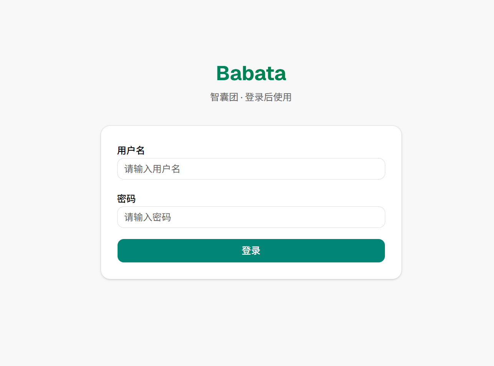
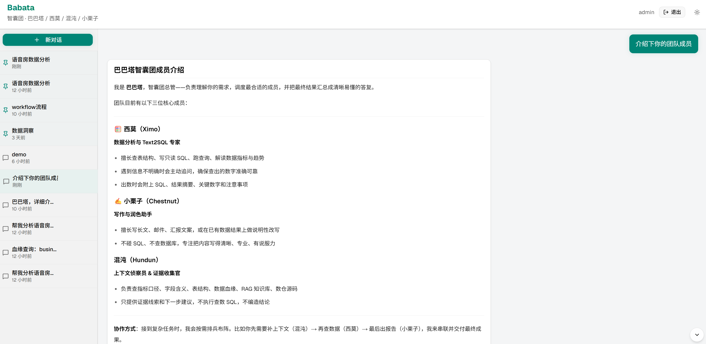
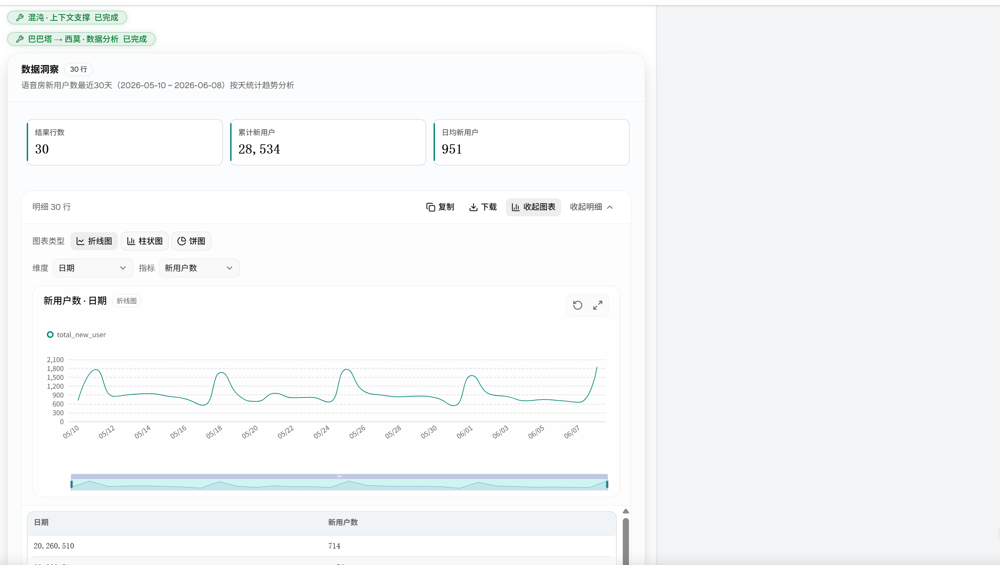
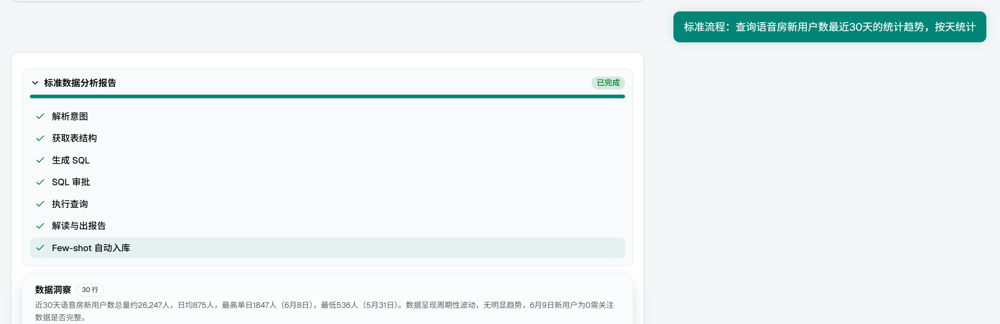
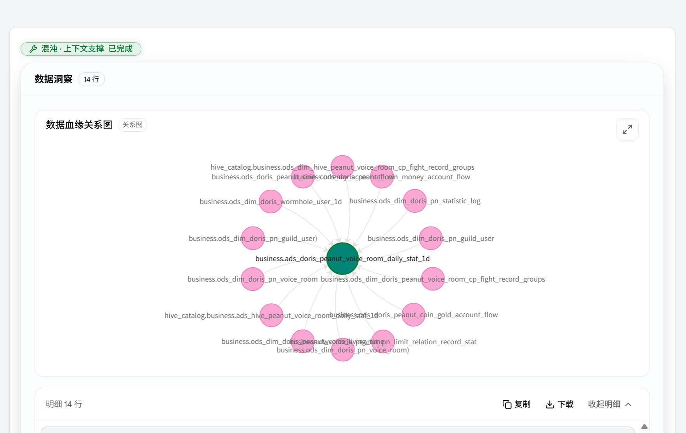
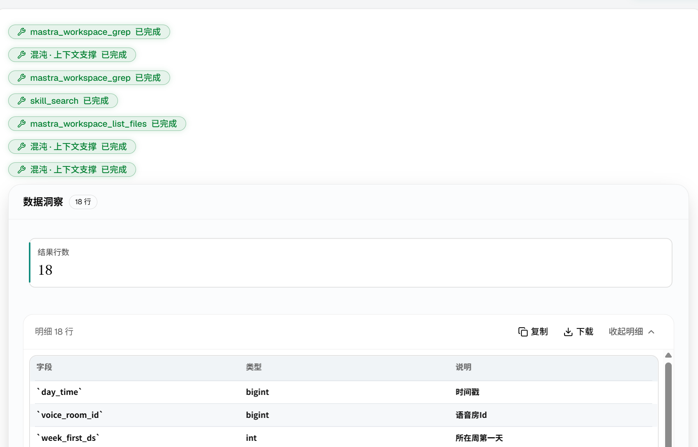

# Babata

- 项目说明与开发文档见 [docs/README.md](./docs/README.md)。
- 规格说明书见 [docs/specs/](./docs/specs/README.md)。
- 实施计划见 [docs/superpowers/plans/](./docs/superpowers/plans/)。

# 项目特色

- 多Agent架构+workflow
- 全栈TypeScript
- SSE流式传输
- 支持横向扩展
- 支持Docker部署
- 接入SKILLS+Tools，支持无限扩展

# 目前Agent实现(可二开横向扩展)

- 巴巴塔（babata）：总管Agent，通过UI同用户对话，判断用户意图，自主拆解任务，分发给子Agent，收集子Agent结果，整理后发给用户。
- 西莫（ximo）：数据分析专家，接入数仓（支持doris/impala），分析用户意图，text2sql,sql校验守卫，执行查询，数据分析。支持反向澄清。
- 混沌（hundun）：证据收集员，支持搜索代码仓库，查找sql片段；对接血缘系统；对接RAG；字段口径、建表语句、出数逻辑，供证据线索。
- 小栗子（chestnut）：擅长写长文、邮件、汇报文案，或在已有数据结果上做说明性改写。
- Workflow：执行固定流程，例如数据分析并产出专业分析报告；周报；邮件等。

# 运行方式

- 复制.env.example 为.env，填写模型base url/app_key等
- 运行pnpm install 、 pnpm build 安装依赖并构建项目
- 启动项目：pnpm start，页面访问[http://localhost:3000](http://localhost:3000)

# 创建用户

- 创建用户: pnpm user:create <用户名> <密码>
- 修改密码: pnpm user:chpwd <用户名> <新密码>

# 示例界面

