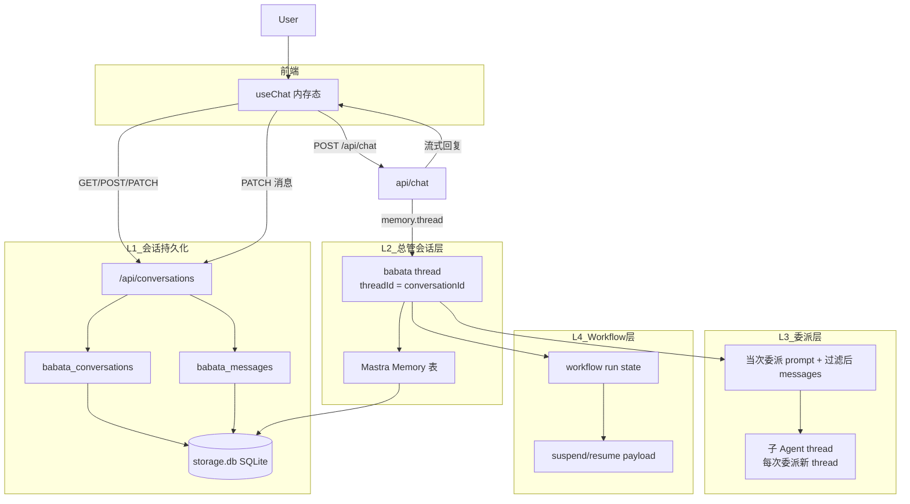
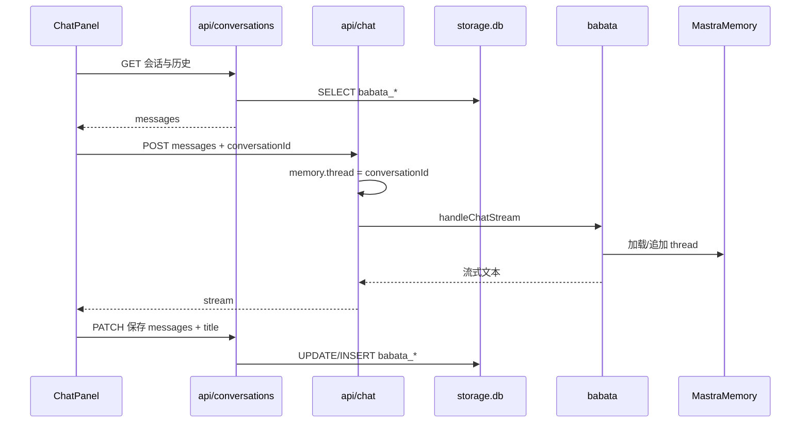

# 上下文管理与记忆机制 — 规格说明书

| 项目 | 说明 |
|------|------|
| 文档版本 | 0.2.0 |
| 状态 | Draft |
| 创建日期 | 2026-06-02 |
| 关联文档 | [multi-agent-think-tank.md](./multi-agent-think-tank.md) |
| 适用范围 | `agent/babata` 多 Agent 智囊团 |

---

## 1. 目标与非目标

### 1.1 目标

为多 Agent 智囊团定义可落地的**上下文分层**与**记忆持久化**方案，明确：

- 用户对话存在哪里、由谁读写；
- 巴巴塔、西莫、小栗子、Workflow 各自持有何种上下文；
- 与 `ChatPanel`（`useChat`）、会话 API 如何衔接；
- 长对话与多次委派场景下如何控制 token、避免总管编造数据。

**存储约束**：会话与消息**不使用**浏览器 `localStorage`，统一写入服务端嵌入式数据库 **SQLite**（通过 LibSQL 访问本地文件，默认 `file:./storage.db`）。

### 1.2 非目标（本期规格不覆盖实现）

- 具体 TypeScript 实现细节（表迁移脚本、完整 API 代码）；
- `@mastra/memory` 安装与 API 改造细节；
- 前端 HITL 审批组件；
- 多用户租户与 RBAC；
- 浏览器端 IndexedDB / sql.js 离线库（一律走服务端 SQLite）。

---

## 2. 四层上下文模型



### 2.1 层级定义

| 层级 | 标识 | 存储 | 内容 | 生命周期 |
|------|------|------|------|----------|
| **L1** | `conversationId` | **SQLite** `storage.db`（应用表 `babata_*`） | 用户可见：会话列表、标题、UIMessage 序列化 JSON | 删除会话或清空库 |
| **L2** | `threadId = conversationId` | **同一** `storage.db`（Mastra Memory 表） | 总管侧完整对话、委派轮次元数据 | 与会话绑定 |
| **L3** | `subAgentThreadId`（Mastra 自动生成） | 同上（子 Agent Memory 表） | **仅**委派 prompt + 子 Agent 回复 | 单次委派 |
| **L4** | `workflowRunId` | 同上（Workflow 表） | 步骤 state、SQL 草案、HITL 载荷 | 单次 workflow run |

前端 React 状态仅为**当前页的内存缓存**；刷新页面后从 SQLite 经 API 重新加载，**不**写入 `localStorage`。

### 2.2 设计原则

1. **单一对外叙事**：用户只与巴巴塔对话；L1 表不存西莫内部 SQL 全文（可选「展开委派详情」产品模式）。
2. **本地嵌入式库**：一个 SQLite 文件（默认项目根目录 `storage.db`），应用会话表与 Mastra 表共存；与 [mastra/index.ts](../../src/mastra/index.ts) 中 `LibSQLStore` 使用同一 URL（`file:./storage.db`）。
3. **L1 为 UI 真相源**：列表、历史消息、标题以 `babata_conversations` / `babata_messages` 为准；L2 服务于 Agent 推理与委派，二者通过相同 `conversationId` 关联。
4. **子 Agent 隔离（L3）**：遵循 [Mastra Supervisor Memory isolation](https://mastra.ai/docs/agents/supervisor-agents#memory-isolation)。
5. **Workflow 独立（L4）**：与 L1 消息表分离；完成后以结构化结果注入总管下一轮。

---

## 3. ID 映射与数据结构扩展

### 3.1 ID 映射表

| 字段 | 值 | 说明 |
|------|-----|------|
| `conversationId` | UUID | 创建会话时由 API 生成并写入 SQLite |
| `memory.thread` | `conversationId` | `handleChatStream` 的 `params.memory.thread` |
| `memory.resource` | `babata-local-user`（常量，可配置） | 单用户应用；多用户时改为 `userId` |
| `useChat.id` | `conversationId` | 与 `ChatPanel` 已对齐 |
| `workflowRunId` | UUID | 见 §3.2 |

**会话切换**：新 `conversationId` → 新 Mastra thread → 子 Agent / Workflow 上下文自然隔离。

### 3.2 SQLite 应用表结构（L1）

与 Mastra 内部表**命名空间隔离**，使用 `babata_` 前缀，避免冲突。

**`babata_conversations`**

| 列 | 类型 | 说明 |
|----|------|------|
| `id` | TEXT PK | `conversationId` |
| `title` | TEXT | 列表展示标题 |
| `type` | TEXT | 默认 `chat` |
| `metadata` | TEXT | JSON，含 HITL / workflow 字段 |
| `created_at` | TEXT | ISO 8601 |
| `updated_at` | TEXT | ISO 8601 |

**`babata_messages`**

| 列 | 类型 | 说明 |
|----|------|------|
| `id` | TEXT PK | 消息 id |
| `conversation_id` | TEXT FK | 关联会话 |
| `role` | TEXT | `user` / `assistant` / `system` |
| `parts` | TEXT | UIMessage `parts` 的 JSON |
| `sort_order` | INTEGER | 会话内顺序 |
| `created_at` | TEXT | 可选 |

`metadata` JSON 结构（实现阶段）：

```ts
{
  activeWorkflowRunId?: string
  pendingApproval?: { workflowId: string; payload: unknown }
}
```

### 3.3 会话 API（L1 读写）

| 方法 | 路径 | 说明 |
|------|------|------|
| GET | `/api/conversations` | 列表（按 `updated_at` 降序） |
| POST | `/api/conversations` | 新建空会话 |
| GET | `/api/conversations/[id]` | 单会话 + 消息 |
| PATCH | `/api/conversations/[id]` | 更新 `title`、`messages` |
| DELETE | `/api/conversations/[id]` | 删除会话及消息 |

前端 [conversation-store.ts](../../src/lib/conversation-store.ts) 改为调用上述 API 的客户端封装；**删除**所有 `localStorage` 读写。

HITL 恢复 API（`POST /api/workflow/resume`）列为 P3。

---

## 4. 请求链路与持久化策略

### 4.1 时序



### 4.2 L1 + L2 协同（非 localStorage 双写）

| 步骤 | L1（SQLite 应用表） | L2（Mastra Memory） |
|------|---------------------|---------------------|
| 打开会话 | `GET /api/conversations/:id` 加载消息 | — |
| 用户发送 | `PATCH` 保存 user 消息（可在 stream 前或后） | `handleChatStream` 传入 `memory.thread` |
| 助手完成 | `PATCH` 保存 assistant 消息 | Mastra 自动追加总管 thread |
| 新建/删会话 | `POST` / `DELETE` | 新 thread / 可选清理 Mastra thread（远期） |

**聊天请求**：`useChat` 仍可携带当前 `messages[]`（兼容 AI SDK v6）；**持久化**只落 SQLite，不经浏览器存储。

实现阶段 `api/chat` 示意：

```ts
const stream = await handleChatStream({
  mastra,
  agentId: 'babata',
  params: {
    ...params,
    memory: {
      thread: conversationId,
      resource: process.env.BABATA_RESOURCE_ID ?? 'babata-local-user',
    },
  },
})
```

### 4.3 一致性说明

- **展示与列表**：以 L1（`babata_*` 表）为准。
- **Agent 推理上下文**：以 L2（Mastra thread）为准；`threadId` 必须等于 `conversationId`。
- 若 L1/L2 短暂不一致（例如 PATCH 失败），以 L1 为准修复展示，并依赖下一轮 chat 同步 L2；实现阶段可在 `PATCH` 成功后可选触发 thread 对齐任务（P2）。

### 4.4 明确废弃

- 不使用 `localStorage` 存会话或消息。
- 不使用浏览器 IndexedDB 作为会话主存储。

---

## 5. Supervisor 委派上下文

### 5.1 Mastra 默认行为

- 子 Agent **当次推理**可收到总管侧 messages（完整或经 `messageFilter` 裁剪）。
- 子 Agent **长期 Memory** 仅保存：本次委派 prompt + 子 Agent 回复。
- 每次委派使用 **新的子 thread**，避免西莫/小栗子 memory 互相污染。

### 5.2 `messageFilter` 策略表

在巴巴塔 `defaultOptions.delegation.messageFilter` 中按 `primitiveId` 配置：

| primitiveId | 传入策略 | 理由 |
|-------------|----------|------|
| `ximo` | 最近 N 条消息 + `onDelegationStart.modifiedPrompt` 含指标意图 | 控 token；减少无关闲聊 |
| `chestnut` | 最近 N 条，或仅委派 prompt + 上游结构化结果（查数后的 JSON） | 写作不需 SQL tool 明细 |
| `workflow:*` | 用户最后一轮 + workflow 输入 schema | 步骤 state 在 L4 已持有 |

默认 `N = 20`，可通过环境变量 `MEMORY_LAST_MESSAGES` 配置。

过滤逻辑示意：

```ts
messageFilter: ({ messages, primitiveId, prompt }) => {
  const n = Number(process.env.MEMORY_LAST_MESSAGES ?? 20)
  const recent = messages.slice(-n)
  if (primitiveId.startsWith('workflow-')) {
    return recent.filter(/* 仅保留最后一轮 user + system */)
  }
  return recent
}
```

### 5.3 Delegation Hooks

| Hook | 用途 |
|------|------|
| `onDelegationStart` | `ximo`：追加只读 SQL 约束；workflow：注入 `runId`；可 `modifiedPrompt` / `modifiedMaxSteps` |
| `onDelegationComplete` | 失败时 `feedback` 写入总管 thread；禁止总管在无结果时编造数据 |

### 5.4 总管模型上下文边界

- 默认 **不** 设置 `includeSubAgentToolResultsInModelContext: true`。
- 总管下一轮仅见子 Agent **文本结果**，不见嵌套 tool 参数/原始行集。
- 调试时可经环境变量 `INCLUDE_SUBAGENT_TOOLS_IN_CONTEXT=true` 打开。

---

## 6. 子 Agent 记忆隔离说明

### 6.1 西莫第二次被调用时「记得什么」

| 类型 | 是否保留 |
|------|----------|
| 当次委派 prompt（含总管改写后的任务） | ✅ 当次可见 |
| 当次可见的过滤后对话（messageFilter） | ✅ 当次可见 |
| 上一次委派存在西莫自己 thread 里的 SQL 细节 | ❌ 不自动带入（新 thread） |
| 总管汇总过的结论（在 L2 thread 里） | ✅ 总管可见，经再次委派 prompt 间接传递 |

因此：**跨轮数据依赖应通过巴巴塔汇总后写入 L2，或在 `modifiedPrompt` 中显式附带**，不能假设西莫 memory 自动记住上次 SQL。

### 6.2 小栗子

与西莫相同隔离规则；适合接收巴巴塔传入的「西莫分析摘要」作为委派 prompt 的一部分，而非直接读西莫 thread。

---

## 7. Workflow 与 HITL 上下文

参考仓库内 `repo-analyzer` 的 `human-approval` step 模式。

| 阶段 | 上下文位置 | 前端可见 |
|------|------------|----------|
| 运行中 | `workflowRun` 各 step output | 可选步骤进度 |
| suspend | `suspendSchema` payload（如 SQL 草案） | 审批 UI（P3） |
| resume | `resumeData` 写入 run | — |
| 完成 | 结构化 JSON → 总管 prompt | 巴巴塔总结写入 L1（`babata_messages`） |

Workflow 完成后，巴巴塔将 L4 输出摘要为面向用户的 Markdown；`babata_messages` 不保存中间 step 全文（除非开启调试模式）。`metadata.activeWorkflowRunId` 存于 `babata_conversations.metadata`。

---

## 8. 存储分工

| 数据 | 层级 | 位置 | 读写方 |
|------|------|------|--------|
| 会话列表、标题、UIMessage | L1 | `storage.db` → `babata_*` 表 | 服务端 API；前端仅 fetch |
| 总管对话、thread 元数据 | L2 | `storage.db` → Mastra 表 | 巴巴塔 Memory |
| 子 Agent 委派记录 | L3 | `storage.db`（子 thread） | Mastra 自动 |
| Workflow run / suspend | L4 | `storage.db` | Workflow 引擎 |
| 西莫 SQL 原始结果 | — | 不默认进 L1 | 可选委派详情 UI |

### 8.1 数据库文件与共享

| 配置 | 默认 | 说明 |
|------|------|------|
| `CONVERSATION_DB_URL` | `file:./storage.db` | 与 Mastra `LibSQLStore` 共用；也可单独 `file:./babata.db`（不推荐双文件） |
| 文件位置 | 项目根目录 | 加入 `.gitignore`；备份即复制 `.db` 文件 |

实现模块建议：

- `src/lib/db.ts` — LibSQL 客户端单例、迁移/建表
- `src/lib/conversation-repository.ts` — L1 CRUD（服务端）
- `src/lib/conversation-store.ts` — 浏览器侧 API 客户端（fetch）

### 8.2 依赖包（实现阶段）

| 包 | 用途 |
|----|------|
| `@libsql/client` | 访问 SQLite 文件（经 `@mastra/libsql` 传递依赖或显式安装） |
| `@mastra/core` | Agent、Supervisor、Memory 抽象 |
| `@mastra/libsql` | `LibSQLStore` → 同一 `storage.db` |
| `@mastra/memory` | 官方 `Memory` 类（L2） |
| `@mastra/ai-sdk` | `handleChatStream` + `memory` 参数 |

**P1 实现前需添加 `@mastra/memory`**；应用表 CRUD 使用 LibSQL 直连或共用 `LibSQLStore` 底层连接。

---

## 9. 环境变量

| 变量 | 默认 | 说明 |
|------|------|------|
| `CONVERSATION_DB_URL` | `file:./storage.db` | L1 SQLite 路径（与 Mastra 一致） |
| `BABATA_RESOURCE_ID` | `babata-local-user` | Mastra `memory.resource` |
| `MEMORY_LAST_MESSAGES` | `20` | messageFilter 保留最近消息条数 |
| `MEMORY_LAST_MESSAGES_BABATA` | `30` | 总管 thread `lastMessages`（P1） |
| `INCLUDE_SUBAGENT_TOOLS_IN_CONTEXT` | `false` | 调试：子 Agent tool 结果进入总管上下文 |

西莫数据库相关变量见 [multi-agent-think-tank.md §9](./multi-agent-think-tank.md#9-环境变量)。

---

## 10. 分阶段落地与验收

| 阶段 | 上下文/记忆能力 | 验收要点 |
|------|-----------------|----------|
| **P1** | SQLite 会话 API + `threadId = conversationId` + `lastMessages: 30` | 无 localStorage；刷新从 DB 恢复；换会话不串话 |
| **P2** | `messageFilter` + delegation hooks | 西莫委派不传全文闲聊；SQL 失败有 feedback |
| **P3** | HITL + `metadata.activeWorkflowRunId` | suspend/resume 后总管能继续总结 |
| **P4** | `semanticRecall` / `workingMemory`（可选） | 长对话可检索历史；用户偏好可持久 |

### P1 记忆相关验收清单

- [ ] 浏览器 `localStorage` 中无 `babata:conversations` 等会话键
- [ ] `babata_conversations` / `babata_messages` 表存在且可读写
- [ ] 刷新页面后会话列表与消息与库内一致
- [ ] `memory.thread` 与 `conversationId` 一致
- [ ] 新建会话使用新 thread，旧会话历史不泄漏
- [ ] `storage.db` 中可观察到总管 thread 消息增长

### P4 可选：会话压缩

每 10 轮由巴巴塔委派小栗子生成「会话摘要」，写入 thread `metadata.summary`；更早消息在 `messageFilter` 中降权或跳过。本项为优化，非 P1 阻塞。

---

## 11. 风险与对策

| 风险 | 影响 | 对策 |
|------|------|------|
| L1 与 L2 不一致 | 展示与推理上下文偏差 | 以 L1 修 UI；`threadId` 强绑定；P2 对账任务 |
| SQLite 文件锁/并发 | 开发环境写入失败 | 单进程 Next dev；生产注意 serverless 限制（远期） |
| `.db` 体积增长 | 磁盘占用 | 删除会话级联删消息；远期归档 |
| messageFilter 过狠 | 子 Agent 缺上下文 | 按 primitive 调 N；关键数据走 `modifiedPrompt` |
| 总管编造数据 | 信任危机 | 指令禁止；`onDelegationComplete` 强制 feedback |
| token 膨胀 | 成本与延迟 | `lastMessages`、过滤、P4 摘要 |
| 子 Agent thread 堆积 | DB 体积 | Mastra 管理；可按 resource 清理策略（远期） |

---

## 12. 修订记录

| 版本 | 日期 | 说明 |
|------|------|------|
| 0.2.0 | 2026-06-02 | L1 改为 SQLite（`storage.db`），废弃 localStorage；补充应用表与 REST API |
| 0.1.0 | 2026-06-02 | 初稿：四层上下文、委派过滤、Workflow/HITL |
