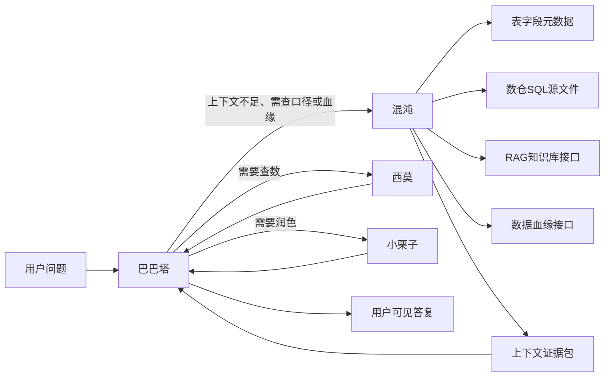

# 混沌（Hundun）上下文支撑智能体 — 规格说明书

| 项目 | 说明 |
|------|------|
| 文档版本 | 0.1.0 |
| 状态 | Draft |
| 创建日期 | 2026-06-05 |
| 适用范围 | `agent/babata` |
| 技术栈 | Mastra Agent、Next.js App Router、LibSQL、Doris 元数据、可配置本地源码检索 |

---

## 1. 背景与目标

### 1.1 背景

当前 Babata 智囊团包含：

- **巴巴塔（babata）**：总管理解用户意图、协调子 Agent 与 Workflow；
- **西莫（ximo）**：负责 Text2SQL、查数、数据分析与可视化；
- **小栗子（chestnut）**：负责写作、润色与表达优化。

在实际数据分析场景中，用户意图经常依赖额外上下文，例如：

- 指标口径、表含义、字段含义；
- 指标与表之间的血缘关系；
- 历史问答、已审批 SQL、RAG 知识库资料；
- 数仓任务或 SQL 源文件中的业务逻辑。

如果巴巴塔缺少这些上下文，直接委派西莫查数容易出现选错表、字段理解错误、时间口径不一致等问题。因此新增 **混沌（hundun）**，作为上下文侦察与证据收集智能体。

### 1.2 目标

混沌的目标是：接受巴巴塔对用户意图的理解，查询可用上下文来源，并返回可审计的“上下文证据包”，辅助巴巴塔更准确地理解用户需求，再决定是否委派西莫查数。

第一版目标：

- 注册 `hundun` 为 Babata 可委派子 Agent；
- 支持表/字段元数据检索；
- 支持受限的本地 SQL/文档源文件探查；
- 为 RAG 与血缘查询预留工具接口；
- 未配置 RAG/血缘时明确返回不可用，不编造结果；
- 通过委派审计日志记录巴巴塔与混沌的 prompt、context、result、feedback。

### 1.3 非目标

第一版不做以下事项：

- 不让混沌执行业务分析 SQL；
- 不让混沌生成最终数据结论或报告；
- 不实现向量数据库、嵌入模型或完整 RAG 索引管道；
- 不内建血缘图谱存储；
- 不允许任意文件系统读取，只允许读取配置白名单内的源码目录；
- 不新增混沌独立对外 API。

---

## 2. 角色定位

### 2.1 Agent 身份

| 字段 | 值 |
|------|----|
| id | `hundun` |
| 中文名 | 混沌 |
| 英文标识 | Hundun |
| 类型 | Babata 子 Agent |
| 主要职责 | 上下文侦察、口径检索、证据收集 |

### 2.2 职责

混沌负责：

- 根据巴巴塔传入的用户意图，寻找可能相关的表、字段、指标口径；
- 查询数据血缘接口，获取上下游表、任务、字段来源；
- 查询 RAG 知识库，获取历史文档、口径说明、问答案例；
- 受限探查数仓 SQL 源文件，提取与用户意图相关的 SQL 片段；
- 将检索结果组织成“上下文证据包”返回给巴巴塔。

混沌不负责：

- 不执行 `execute-readonly-sql` 进行查数；
- 不调用 `build-visualization`；
- 不给出未经证据支持的业务结论；
- 不替代西莫生成分析 SQL；
- 不直接向用户输出最终分析报告。

---

## 3. 总体架构



---

## 4. 路由规则

### 4.1 优先委派混沌的场景

巴巴塔应优先委派混沌：

- 用户询问指标口径、字段含义、表含义；
- 用户询问“这个指标怎么算”“这个字段从哪里来”“有没有血缘”；
- 用户要求查 RAG 知识库、查历史案例、查源 SQL；
- 查数问题中缺少明确表名、字段或指标口径，且可以通过上下文检索补齐；
- 用户问题涉及多个可能表或多个业务口径，需要先做证据收集。

### 4.2 不委派混沌的场景

巴巴塔不应委派混沌：

- 普通闲聊、概念解释、与项目数据无关的短问答；
- 用户已经明确表、字段、时间范围且只需查数，应直接委派西莫；
- 用户明确要求标准 Workflow，应触发对应 Workflow；
- 已有西莫查数结果，只需润色时应委派小栗子。

### 4.3 推荐执行顺序

| 用户意图 | 推荐处理方 |
|----------|------------|
| 明确查数 | 西莫 |
| 查数但口径不清 | 混沌 → 西莫 |
| 查指标口径、表含义、字段来源 | 混沌 |
| 查血缘、查源 SQL、查知识库 | 混沌 |
| 先查上下文再写报告 | 混沌 → 西莫 → 巴巴塔/小栗子 |

---

## 5. 工具能力

### 5.1 第一版工具清单

| 工具 | 说明 | 第一版实现 |
|------|------|------------|
| `list-context-tables` | 列出可访问的数据表 | 复用 Doris 元数据能力 |
| `describe-context-table` | 查看表结构与字段注释 | 复用 Doris 元数据能力 |
| `glob-warehouse-sources` | 按模式列出数仓源码文件 | 新增，白名单目录内只读 |
| `search-warehouse-sources` | 搜索 SQL/文档源文件内容 | 新增，限制结果数与片段长度 |
| `read-warehouse-source` | 读取单个源文件片段 | 新增，路径白名单与长度限制 |
| `query-rag-knowledge` | 查询 RAG 知识库 | 第一版接口占位，未配置时返回不可用 |
| `query-data-lineage` | 查询数据血缘 | 第一版接口占位，未配置时返回不可用 |

### 5.2 本地源码探查边界

本地源码工具必须满足：

- 只允许访问 `HUNDUN_SOURCE_ROOTS` 配置的目录；
- 默认扩展名白名单：`.sql`、`.hql`、`.md`、`.yaml`、`.yml`、`.ts`、`.tsx`；
- 禁止路径穿越；
- 限制单次读取字符数；
- 限制搜索结果数量；
- 返回路径、行号、片段、命中关键词，不返回整仓内容。

### 5.3 RAG 与血缘接口边界

第一版不假设真实 RAG 或血缘系统已经存在。

当未配置时，工具应返回：

```json
{
  "configured": false,
  "message": "RAG 知识库未配置，无法查询。",
  "results": []
}
```

或：

```json
{
  "configured": false,
  "message": "数据血缘接口未配置，无法查询。",
  "results": []
}
```

混沌必须把“未配置”如实反馈给巴巴塔，不得伪造检索结果。

---

## 6. 上下文证据包

混沌返回给巴巴塔的结果应采用 Markdown，并包含结构化段落：

```markdown
## 混沌上下文证据包

### 意图理解
- 用户想了解：...
- 可能涉及业务对象：...

### 候选表与字段
- 表：...
  - 证据：字段注释 / 表注释 / 源文件命中
  - 置信度：高/中/低

### 口径与血缘线索
- ...

### RAG / 历史案例
- ...

### 源 SQL 片段
- 文件：...
- 片段：...

### 待确认问题
- ...

### 给巴巴塔的建议
- 建议下一步：直接委派西莫 / 先向用户澄清 / 暂不查数
```

要求：

- 每条关键判断必须附来源；
- 缺少证据时写“未找到证据”；
- 不输出最终业务结论；
- 不输出未经执行的指标数字。

---

## 7. 审计与日志

混沌相关委派需要记录审计事件：

| 事件 | 内容 |
|------|------|
| `babata-hundun.context` | 巴巴塔传给混沌的近期上下文 |
| `babata-hundun.prompt` | 原始委派 prompt |
| `babata-hundun.modified-prompt` | 追加约束后的 prompt |
| `babata-hundun.result` | 混沌返回结果或错误 |
| `babata-hundun.feedback` | 巴巴塔对混沌结果的反馈 |

审计日志继续复用 `src/lib/audit-log.ts`，受 `BABATA_AUDIT_LOG` 与 `BABATA_AUDIT_LOG_FILE` 控制。

---

## 8. 配置项

新增配置项必须遵守配置注释规范，示例：

```env
# 混沌可读取的数仓源码根目录，多个目录用英文逗号分隔
HUNDUN_SOURCE_ROOTS=

# 混沌源码检索允许的文件扩展名，多个扩展名用英文逗号分隔
HUNDUN_SOURCE_EXTENSIONS=.sql,.hql,.md,.yaml,.yml,.ts,.tsx

# 混沌单次源码搜索最多返回的命中条数
HUNDUN_SOURCE_SEARCH_LIMIT=20

# 混沌单次源码读取最多返回的字符数
HUNDUN_SOURCE_READ_MAX_CHARS=12000

# 混沌 RAG 知识库查询接口地址，留空表示未配置
HUNDUN_RAG_ENDPOINT=

# 混沌数据血缘查询接口地址，留空表示未配置
HUNDUN_LINEAGE_ENDPOINT=

# 混沌专用模型，留空时回退 MODEL_NAME
MODEL_HUNDUN=
```

---

## 9. 安全约束

- 混沌不持有 SQL 执行工具；
- 混沌文件工具必须做路径白名单校验；
- 混沌不得读取 `.env`、密钥、证书、日志等敏感文件；
- 混沌不得把未配置的 RAG/血缘接口伪装为查询成功；
- 混沌不得将源码文件全文无边界塞入回答；
- 巴巴塔收到混沌证据包后，仍需区分“证据线索”和“已查数事实”。

---

## 10. 代码落地点

| 文件 | 变更 |
|------|------|
| `src/mastra/instructions/hundun.ts` | 新增混沌 description 与 instructions |
| `src/mastra/agents/hundun.ts` | 新增混沌 Agent |
| `src/mastra/tools/context/*` | 新增上下文检索工具 |
| `src/mastra/instructions/index.ts` | 导出混沌 instructions |
| `src/mastra/registry.ts` | 注册混沌并加入 Babata 子 Agent 列表 |
| `src/mastra/instructions/routing.ts` | 增加混沌路由规则 |
| `src/mastra/delegation.ts` | 增加混沌委派过滤、prompt 约束、审计日志 |
| `src/mastra/index.ts` | 注册混沌 Agent |
| `src/mastra/agents/babata.ts` | 将混沌挂载到 Supervisor |
| `src/lib/model.ts` | 增加 `hundun` 模型角色 |
| `src/app/components/ChatPanel.tsx` | 增加混沌委派 UI 标签 |
| `.env.example` | 增加混沌配置示例与中文注释 |

---

## 11. 测试策略

### 11.1 单元测试

- `src/mastra/instructions/hundun.test.ts`
  - 验证混沌 instructions 包含“只返回证据包”“不执行 SQL”“不编造”等约束；
  - 验证 description 适合 Babata 路由。

- `src/mastra/registry.test.ts`
  - 验证 Babata instructions 包含混沌；
  - 验证路由表包含口径、血缘、RAG、源 SQL 场景；
  - 验证 `getDelegationLabel()` 能识别 `hundun`。

- `src/mastra/delegation.test.ts`
  - 验证混沌委派 prompt 追加证据包约束；
  - 验证混沌委派审计日志；
  - 验证混沌失败时反馈给巴巴塔不要编造。

- `src/mastra/tools/context/*.test.ts`
  - 验证源码 glob/search/read 的白名单、路径穿越防护、扩展名限制、输出截断；
  - 验证 RAG/血缘未配置时返回 `configured:false`。

### 11.2 验证命令

```bash
pnpm exec tsx --test "src/mastra/instructions/hundun.test.ts"
pnpm exec tsx --test "src/mastra/registry.test.ts"
pnpm exec tsx --test "src/mastra/delegation.test.ts"
pnpm exec tsx --test "src/mastra/tools/context/*.test.ts"
pnpm exec tsc --noEmit
```

---

## 12. 验收标准

- 巴巴塔 system instructions 中出现混沌角色与路由规则；
- 巴巴塔可委派 `hundun`；
- 混沌可返回上下文证据包；
- 混沌不会执行查数 SQL；
- 未配置 RAG/血缘时明确说明不可用；
- 本地源码探查受白名单与长度限制保护；
- 相关审计日志可用；
- 现有西莫、小栗子与 Workflow 路由不回归。

