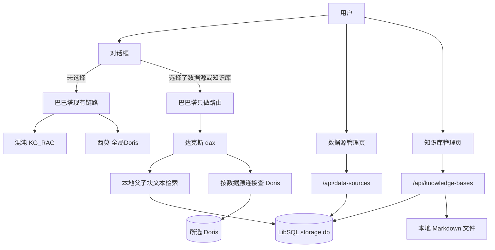

# 数据源与知识库（RAG）管理技术方案

在不改动现有巴巴塔 / 混沌 / 西莫链路的前提下，新增「数据源管理」「知识库（RAG，Retrieval-Augmented Generation，检索增强生成）管理」两个独立模块，以及对话选择后走新 Agent「达克斯（dax）」的本地问数 / 问答路径。一期只做 Doris 连接与 Markdown 父子块文本检索。

## 需求边界

- 两个模块独立 CRUD：数据源、知识库。
- 一个数据源可绑定 1 到多个知识库；知识库也可单独存在、单独问答。
- **一期数据源**：只支持 Doris（连接信息可配置）。CSV / Excel / PDF / MySQL 只预留类型，不做实现。
- **一期知识库**：只支持 Markdown 上传 → 解析 → 父子分块 → 文本索引。不做向量嵌入。
- **对话**：用户可选择数据源、知识库或两者；选中后走新 Agent **达克斯（dax）**。
- **硬约束（已确认）**：不改现有 Agent 与子 Agent（巴巴塔、混沌、西莫、小栗子、巨斧）。未选择本地数据源 / 知识库时，仍走「确认查询 → 混沌 `KG_RAG_ENDPOINT` → 西莫全局 `DORIS_*`」。

## 方案对比与推荐

- **方案 A（推荐，已确认）**：新增达克斯 Agent + 本地存储 / 检索。对话带上选择后，巴巴塔只多一条路由：委派达克斯。混沌 / 西莫一行不改。
- **方案 B**：改造混沌 / 西莫直接读本地库。改动面大，和现有外部 RAG、全局 Doris 耦合，否决。
- **方案 C**：独立 RAG 微服务。一期过重，否决。

## 现状锚点

- 对话入口：`src/app/api/chat/route.ts` 已能传 `requestContext`；`src/app/components/ChatPanel.tsx` 目前没有数据源 / 知识库选择器。
- 路由表：`src/mastra/instructions/routing.ts` 按意图委派，需在最上方加「已选本地数据源或知识库 → 达克斯」。
- Agent 注册：`src/mastra/index.ts`。
- 存储：`src/lib/db/schema.ts` 的 LibSQL `storage.db`，按 `user_id` 隔离会话。
- 查数：`src/mastra/tools/db/doris-client.ts` + `src/mastra/tools/db/sql-guard.ts`。达克斯复用只读守卫，但连接来自所选数据源，不读全局 `DORIS_*`。

## 目标架构

## 数据模型（LibSQL）

全部带 `user_id`，列表 / 读写按当前登录用户过滤（与会话一致）。

- `babata_data_sources`：`id, user_id, name, description, type, enabled, config_json, created_at, updated_at`
  - 一期 `type = doris`；`config_json` 存 host / port / user / database 等；密码用 `BABATA_DATA_SOURCE_SECRET` 对称加密后入库，禁止明文、禁止写进对话日志。
  - 后续预留 `mysql` / `file_csv` / `file_excel` / `file_pdf`。
- `babata_knowledge_bases`：`id, user_id, name, description, enabled, source_type, created_at, updated_at`
  - 一期 `source_type = markdown`。
- `babata_data_source_knowledge_bindings`：`data_source_id, knowledge_base_id, user_id`，唯一约束 `(data_source_id, knowledge_base_id)`。删除任一侧时级联解绑。
- `babata_knowledge_documents`：`id, knowledge_base_id, filename, storage_path, parse_status, parse_error, created_at`
- `babata_knowledge_parent_chunks`：`id, document_id, heading_path, content, sort_order`
- `babata_knowledge_child_chunks`：`id, parent_id, content, sort_order`
- FTS5 虚表 `babata_knowledge_child_fts`：对 child `content` 建文本索引（tokenize = unicode61），检索只扫小块。

绑定语义：

- 对话只选数据源：达克斯自动检索该数据源已绑定且启用的知识库。
- 对话只选知识库：只做知识库问答，不查 Doris。
- 两者都选：用所选知识库生成口径 / SQL 线索，再对所选 Doris 执行只读 SQL。

## 知识库：解析、父子块、文本召回

一期不做嵌入。检索 = SQLite FTS5 关键词检索。

1. 上传 `.md` 到 `data/knowledge/{userId}/{knowledgeBaseId}/`（gitignore），记录 `storage_path`。
2. 按标题层级切 **父块**：以 `h2` / `h3` 为段（无标题则整篇一个父块）；父块保留完整小节，供 LLM 阅读。
3. **子块**：父块按段落 / 窗口切（约 200–400 字，重叠约 40 字），只用于检索。
4. 召回：FTS5 查子块 TopK → 按 `parent_id` 去重 → 返回父块全文（「小块索引、大块召回」）。
5. 解析失败写 `parse_status=failed` + `parse_error`，管理页可重试。

工具契约（达克斯）：`retrieve-local-knowledge`，入参 `{ knowledgeBaseIds, query, childLimit }`，出参 `{ parents: [{ headingPath, content, childHits }] }`。

## 数据源：一期 Doris

- 管理页：新建 / 编辑 / 启停 / 删除 / 测试连接；「绑定知识库」多选已有知识库。
- 测试连接：临时解密配置，建短连接 `SELECT 1`，不落日志密码。
- 达克斯工具 `execute-readonly-sql-on-source`：按 `dataSourceId` 取配置建连接（可短缓存池），**必须**复用现有 `src/mastra/tools/db/sql-guard.ts`（只读、LIMIT、超时）。禁止达克斯使用全局 `queryDoris()`。
- 可选只读元数据：`list-source-tables` / `describe-source-table`，仅达克斯可用，便于生成 SQL。

## 新 Agent：达克斯（dax）

新增文件对齐现有风格：

- `src/mastra/agents/dax.ts`
- `src/mastra/instructions/dax.ts`
- `workspace/agents/dax/skills/...`
- 在 `src/mastra/index.ts` 注册；`src/lib/model.ts` 增加 `MODEL_DAX`（可回退 `MODEL_NAME`）。

职责：

- 有知识库：先 `retrieve-local-knowledge`，用父块回答口径 / 字段 / 表含义。
- 有数据源且用户要出数：根据检索结果写 SQL，经只读工具查所选 Doris，再可视化（可复用西莫的 `build-visualization` 实现，作为达克斯自己的工具包装，不调用西莫 Agent）。
- 信息不足：文本追问，不编造数字。
- 不调用混沌、不调用 `KG_RAG_ENDPOINT`、不走 `confirm-normalized-query`（本地选择已表达意图；若后续要确认框可二期再加）。

巴巴塔改动（仅路由与委派注册，不改混沌 / 西莫实现）：

- `routingDecisionTable` 最上方新增一行：请求上下文带 `selectedDataSourceId` 或 `selectedKnowledgeBaseId` → 只委派达克斯。
- `src/mastra/agents/babata.ts` 增加 `dax` 委派工具。
- `src/app/api/chat/route.ts` 把前端选择写入 `requestContext`，供 instructions / 工具读取。

未选择时，现有决策表一行不改。

## 对话选择器（前端）

现有首页是单页聊天。管理功能做成独立路由，聊天区加选择器：

- 新页：`/data-sources`、`/knowledge-bases`（需登录，middleware 已按路径拦未登录）。
- 首页 `src/app/page.tsx` 侧栏增加「我的数据」入口（数据源 / 知识库），视觉跟巴巴塔现有主题，不照搬 InfiniSynapse。
- `src/app/components/ChatPanel.tsx` 输入区增加两个选择器：数据源、知识库；选择结果随 `POST /api/chat` 的 `body` 发送。
- 会话 `metadata` 可记下最近一次选择，刷新后恢复；换会话互不影响。

一期管理页能力：

- 数据源：搜索、类型 / 启用筛选、启停开关、编辑、绑定知识库、删除、新建 Doris。
- 知识库：搜索、启用筛选、新建、上传 Markdown、看解析状态、删除。

## API 草案

- `GET/POST /api/data-sources`，`GET/PATCH/DELETE /api/data-sources/[id]`，`POST /api/data-sources/[id]/test`，`PUT /api/data-sources/[id]/bindings`
- `GET/POST /api/knowledge-bases`，`GET/PATCH/DELETE /api/knowledge-bases/[id]`，`POST /api/knowledge-bases/[id]/documents`（multipart），`POST .../documents/[docId]/reparse`
- 配置接口永不回传解密密码（编辑回显用 `passwordSet: true`）。

## 安全与失败

- 密码加密存储；审计日志只记 `dataSourceId` / `knowledgeBaseId`，不记连接串。
- SQL 必须过只读守卫；连接失败、检索为空、解析失败都要有明确用户文案。
- 文件只允许 `.md`；大小上限用配置（如 `BABATA_KNOWLEDGE_UPLOAD_MAX_MB`，默认 5）。
- 跨用户禁止读写他人数据源 / 知识库。

## 测试策略（先测后写）

- 绑定：一对多、解绑、删除级联。
- 父子块：标题切分、无标题退化、FTS 命中子块返回父块。
- 达克斯路由：有选择 → 只委派 dax；无选择 → 路由表不含强制 dax。
- SQL：达克斯用数据源连接；错误配置不得回退全局 `DORIS_*`。
- API：未登录 401；越权 404。

## 分期交付

1. **存储 + CRUD API + 管理页**（无 Agent）：可独立验收增删改查与绑定。
2. **Markdown 解析与 FTS 召回**：上传后能检索父块。
3. **对话选择器 + 达克斯问答**（只选知识库即可问答）。
4. **达克斯查 Doris**：选数据源后用绑定 / 所选知识库生成 SQL 并出数。
5. **以后**：MySQL、文件型数据源、嵌入检索。

## 明确不做（一期）

- 改混沌 / 西莫 / 巨斧行为或下线 `KG_RAG_ENDPOINT`
- 向量库、嵌入模型
- CSV / Excel / PDF / MySQL 实际接入
- 照搬 InfiniSynapse 整站信息架构
