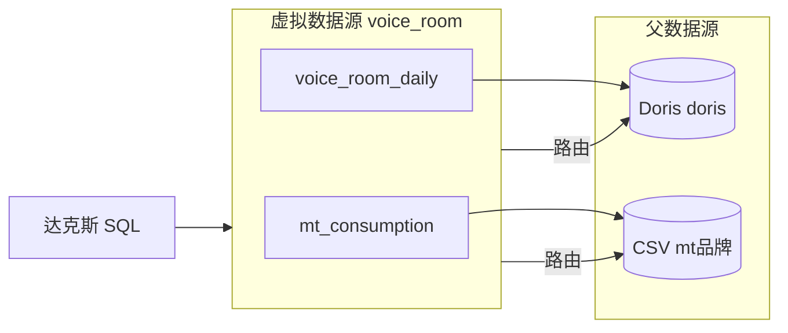

# 虚拟数据源设计规格

从多个已有数据源中挑选特定表，组合为一个**虚拟数据源（virtual data source）**。虚拟数据源在列表、对话选源、RAG 绑定、达克斯查数等行为上与物理数据源一致；底层不复制数据，只做表级视图与 SQL 路由。

## 已确认决策

| 项 | 决策 |
|----|------|
| 父源数量 | **方案 B**：可从多个已有数据源各选表 |
| 跨源 SQL | **方案 B1**：单次 SQL 只能引用**同一父数据源**下的表；不支持跨 Doris + CSV 的 JOIN |
| 嵌套虚拟源 | 一期不支持「虚拟源引用虚拟源」 |
| 数据复制 | 不复制表数据，仅保存绑定元数据 |

## 需求边界

### 要做什么

- 「新建数据源」下拉增加 **虚拟数据源** 入口。
- 创建 / 编辑时可：
  - 多次选择不同父数据源；
  - 从每个父源勾选一张或多张表；
  - 为表设置**对外暴露名**（`exposedName`），供 Agent 与 SQL 使用。
- 虚拟数据源卡片展示：父源数量、表数量、表清单摘要。
- 对话中选虚拟源 → 达克斯 `list-source-tables` / `describe-source-table` / `execute-readonly-sql-on-source` 均走虚拟层。
- 虚拟源可绑定 RAG 知识库，与 Doris / CSV 源相同。

### 不做什么（一期）

- 跨父源 JOIN / 联邦查询。
- 虚拟源再引用虚拟源。
- 表级行级权限、列级脱敏。
- 自动同步父源 schema 变更（删除父表后，虚拟绑定保留但 describe / 查询会报错，管理页需提示）。

## 核心概念



- **父数据源（parent）**：`doris` / `mysql` / `clickhouse` / `starrocks` / `file_csv` / `sqlite` 等已有物理源；**不含** `virtual`。
- **表绑定（binding）**：`(parentDataSourceId, tableName, exposedName)`。
  - `tableName`：在父源中的真实表名（CSV 为逻辑表名）。
  - `exposedName`：虚拟源对外名称；Agent 写 SQL 时使用此名。
- **单父约束（B1）**：一条 SQL 中出现的所有 `exposedName` 必须映射到同一个 `parentDataSourceId`。

## 数据模型

### 类型扩展

`src/lib/db/data-source-config.ts` 增加：

```typescript
// 新增 DataSourceType 成员
'virtual'

type VirtualTableBinding = {
  parentDataSourceId: string
  tableName: string
  exposedName: string
  description?: string
}

type VirtualSourceConfig = {
  tables: VirtualTableBinding[]
}
```

### 对外展示配置

```typescript
type PublicVirtualTableBinding = {
  exposedName: string
  tableName: string
  parentDataSourceId: string
  parentDataSourceName: string
  parentDataSourceType: DataSourceType
  description?: string
}

type PublicVirtualConfig = {
  kind: 'virtual'
  tables: PublicVirtualTableBinding[]
}
```

摘要文案示例：`3 个父源 · 8 张表`。

### 表名冲突

- 虚拟源内 `exposedName` **全局唯一**（跨父源不可重复）。
- 添加表时若与已有 `exposedName` 冲突：
  - UI 默认建议 `{父源简称}_{tableName}`（如 `doris_voice_room`）；
  - 用户可改别名；
  - 保存时服务端校验唯一性。

## 查询与元数据路由

### list-source-tables

返回虚拟 config 中的 `{ name: exposedName, description }` 列表，**不**穿透所有父源全库。

### describe-source-table

1. 按 `exposedName` 查 binding；
2. 加载父源 record；
3. 调用现有 `describeQueryableSourceTable(parent, binding.tableName)`。

### execute-readonly-sql-on-source

1. `assertReadonlySelect`（复用现有守卫）；
2. `extractReferencedTableNames(sql)` 解析 SQL 中的表引用（FROM / JOIN / 逗号分隔多表）；
3. 将引用名映射为 binding；未在白名单内的表名 → 拒绝；
4. 校验所有 binding 的 `parentDataSourceId` 相同，否则：

   > 虚拟数据源不支持跨父源查询。当前 SQL 同时引用了多个父数据源下的表，请拆成多次查询。

5. SQL 重写：`exposedName` → `tableName`（父源内真实名）；
6. 在**父源 record** 上调用现有 `querySelectedDataSource`（CSV 父源仍走物理表名 rewrite）。

### test connection

对虚拟源涉及的所有**去重父源**依次 `testDataSourceConnection`；任一失败则整体失败并返回具体父源名。

## API

| 方法 | 路径 | 说明 |
|------|------|------|
| POST | `/api/data-sources` | `type=virtual`，body 含 `tables[]` |
| PATCH | `/api/data-sources/[id]` | 更新名称、描述、enabled、表绑定列表 |
| GET | `/api/data-sources/[parentId]/tables` | **新增**：列出某父源可选表（供创建 UI）；父源不能是 virtual |
| 现有 | `/api/data-sources/[id]/test` | 虚拟源走多父测试 |

创建请求体示例：

```json
{
  "type": "virtual",
  "name": "语音房业务域",
  "description": "Doris 语音房表 + CSV 消费表",
  "enabled": true,
  "tables": [
    {
      "parentDataSourceId": "ds_doris_1",
      "tableName": "voice_room_daily_stat",
      "exposedName": "voice_room_daily_stat"
    },
    {
      "parentDataSourceId": "ds_csv_1",
      "tableName": "mt_consumption",
      "exposedName": "mt_consumption"
    }
  ]
}
```

## UI 设计

### 新建入口

`DataSourceCreateMenu` 增加一项：**虚拟数据源**（置于列表顶部或独立分组）。

### 创建 / 编辑对话框

分块布局：

1. **基本信息**：名称、描述、启用开关。
2. **已选表列表**：表格列 — 暴露名、父源名、原表名、操作（删除）。
3. **添加表**：
   - 父数据源下拉（仅物理源、已启用）；
   - 「加载表」→ 调 `GET /api/data-sources/{parentId}/tables`；
   - 多选 checkbox + 批量添加；
   - 冲突时弹出 exposedName 编辑。

编辑虚拟源时：父源连接信息只读展示；可增删 binding、改 exposedName。

### 列表卡片

- 类型徽章：`virtual` → 「虚拟数据源」。
- 摘要：`{parentCount} 个父源 · {tableCount} 张表`。
- 展开区：按父源分组展示表清单（与 CSV 库表列表风格一致）。

## 达克斯 Agent

- **无需新工具**；虚拟源对 Agent 透明。
- 可选：在 `dax-selection-context` 注入一句说明 — 当前为虚拟源，跨父源 JOIN 不可用。
- `list-source-tables` 仅返回暴露表，引导 Agent 用暴露名写 SQL。

## 安全与审计

- 虚拟源 SQL 审计日志带 `virtualDataSourceId` + 实际执行的 `parentDataSourceId`。
- 校验用户对所有父源均有读权限（同 user_id 隔离）。
- 父源被删除：虚拟 binding 失效；列表页 / 测试连接提示「父源不存在」。

## 实现模块

| 模块 | 文件 | 职责 |
|------|------|------|
| 配置类型 | `data-source-config.ts` | `virtual` 类型、parse / public config |
| 持久化 | `data-sources.ts` | create / update / delete 虚拟源 |
| SQL 解析 | `virtual-source-sql.ts`（新） | 提取表名、重写、单父校验 |
| 连接层 | `source-connection.ts` | `isVirtualType` 分支委托 |
| 查询层 | `source-query.ts` | execute / list / describe 虚拟路由 |
| API | `api/data-sources/...` | CRUD + tables 子路由 |
| UI | `DataSourceDialogs.tsx`, `page.tsx` | 创建菜单、对话框、卡片 |
| 测试 | `*.test.ts` | 配置解析、SQL 路由、单父约束、API |

## 测试策略

1. **单元**：`extractReferencedTableNames`；exposedName 重写；多父同 SQL 拒绝；单父通过。
2. **集成**：虚拟源 list / describe 委托正确；execute 结果与直连父源一致。
3. **API**：创建多父虚拟源；重名 exposedName 400；父源为 virtual 时 tables 接口 400。
4. **UI**：手动 — 从 Doris + CSV 各选表创建，对话选源查数，绑定 RAG。

## 验收标准

- [ ] 可从 ≥2 个不同物理源选表创建虚拟源。
- [ ] 虚拟源在对话中可选，达克斯能 list / describe / 查数。
- [ ] 单条 SQL 跨两父源时报错清晰。
- [ ] 单父 SQL 结果与直连父源一致（含 CSV 逻辑表名）。
- [ ] 虚拟源可绑定 / 解绑知识库。
- [ ] 测试连接覆盖全部父源。

## 后续扩展（非一期）

- 跨源联邦 JOIN（需执行计划拆分）。
- 虚拟源引用虚拟源（解析为 binding 扁平化）。
- 父源 schema 变更自动检测与告警。
