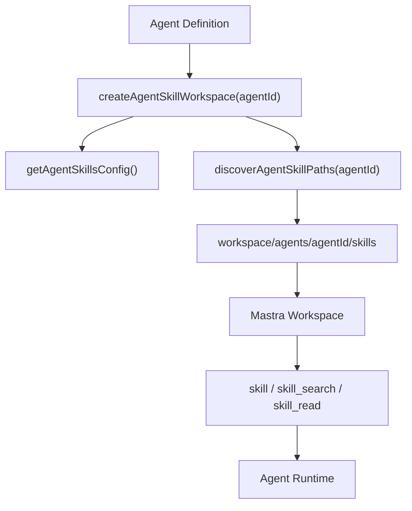

# Agent Skill 隔离与动态加载 — 技术方案与任务清单

> 对应规格：[agent-skill-isolation.md](../specs/agent-skill-isolation.md) v0.1.0

| 项目 | 说明 |
|------|------|
| 文档版本 | 0.1.0 |
| 状态 | Draft |
| 创建日期 | 2026-06-05 |
| 适用范围 | `agent/babata` |
| 目标 | 为 `babata`、`ximo`、`hundun`、`chestnut` 引入严格隔离的 Mastra Agent Skills |

---

## 1. 目标与范围

### 1.1 目标

实现每个 Agent 独立的 Skill Workspace，使 Agent 只能搜索、加载、读取自身目录下的 skills，并支持在任务阶段内动态搜索、加载和切换 skill。

第一版目标：

- 新增 Agent Skill 配置解析；
- 新增每 Agent 独立 Workspace 创建器；
- 创建四个初始 skill 目录与 `SKILL.md`；
- 将 Agent 与对应 Workspace 绑定；
- 在 Agent instructions 中加入 skill 使用边界；
- 为路径隔离、配置解析、Agent 接入补测试；
- 更新 `.env.example` 与文档索引。

### 1.2 非目标

第一版不实现：

- 远程 skill 仓库；
- skill 发布、版本回滚服务；
- skill 管理 UI；
- 用户在聊天中创建或修改 skill；
- 向量化 skill 检索；
- 跨 Agent 共享 skill 池。

---

## 2. 当前代码现状

当前 Mastra 入口在 `src/mastra/index.ts`：

```ts
export const mastra = new Mastra({
  storage: mastraStorage,
  agents: {
    babata: babataAgent,
    ximo: ximoAgent,
    chestnut: chestnutAgent,
    hundun: hundunAgent,
  },
  workflows: {
    dataAnalysisPrep: dataAnalysisPrepWorkflow,
    dataAnalysisReport: dataAnalysisReportWorkflow,
    weeklyMetrics: weeklyMetricsWorkflow,
  },
})
```

当前 Agent 定义分别在：

- `src/mastra/agents/babata.ts`
- `src/mastra/agents/ximo.ts`
- `src/mastra/agents/hundun.ts`
- `src/mastra/agents/chestnut.ts`

现状特点：

- Agent 通过 `instructions` 固化行为；
- 工具通过 `tools` 暴露；
- `babata` 通过 `agents` 和 `workflows` 编排子能力；
- 尚未创建 Mastra `Workspace`；
- 尚未配置 Workspace Skills。

---

## 3. 总体架构

### 3.1 目录结构

新增代码目录：

```text
src/mastra/skills/
  config.ts
  workspace.ts
  instructions.ts
  config.test.ts
  workspace.test.ts
  instructions.test.ts
```

新增 skill 内容目录：

```text
workspace/
  agents/
    babata/
      skills/
        intent-routing/
          SKILL.md
    ximo/
      skills/
        text-to-sql-analysis/
          SKILL.md
    hundun/
      skills/
        context-recon/
          SKILL.md
    chestnut/
      skills/
        report-polishing/
          SKILL.md
```

### 3.2 运行时关系



### 3.3 严格隔离策略

每个 Agent 拥有独立 Workspace：

- `babata` Workspace basePath：`<root>/workspace/agents/babata`
- `ximo` Workspace basePath：`<root>/workspace/agents/ximo`
- `hundun` Workspace basePath：`<root>/workspace/agents/hundun`
- `chestnut` Workspace basePath：`<root>/workspace/agents/chestnut`

Workspace 的 `skills` 仅返回当前 Agent 目录下的 `skills/*`。即使其他 Agent 目录存在，也不进入当前 Agent skill 搜索范围。

---

## 4. 配置设计

### 4.1 配置项

`.env.example` 新增：

```env
# 是否启用 Mastra Agent Skills（false 时不创建 agent skill workspace）
AGENT_SKILLS_ENABLED=true

# Agent Skills 根目录，默认使用项目根目录下 workspace
AGENT_SKILLS_ROOT=workspace

# 是否在每次请求时动态重新发现 skill 目录（开发环境建议 true，生产建议 false）
AGENT_SKILLS_DYNAMIC_DISCOVERY=true
```

### 4.2 `config.ts`

文件：`src/mastra/skills/config.ts`

职责：

- 定义 `SkillAgentId`；
- 解析 `AGENT_SKILLS_ENABLED`；
- 解析 `AGENT_SKILLS_ROOT`；
- 解析 `AGENT_SKILLS_DYNAMIC_DISCOVERY`；
- 标准化根目录为绝对路径；
- 给开发环境和生产环境设置合理默认值。

建议类型：

```ts
export type SkillAgentId = 'babata' | 'ximo' | 'hundun' | 'chestnut'

export type AgentSkillsConfig = {
  enabled: boolean
  root: string
  dynamicDiscovery: boolean
}
```

建议函数：

```ts
export function getAgentSkillsConfig(
  env: Record<string, string | undefined> = process.env,
): AgentSkillsConfig
```

默认策略：

- `AGENT_SKILLS_ENABLED` 未配置时默认 `true`；
- `AGENT_SKILLS_ROOT` 未配置时默认 `workspace`；
- `AGENT_SKILLS_DYNAMIC_DISCOVERY` 未配置时，`NODE_ENV === 'production'` 为 `false`，其他环境为 `true`。

---

## 5. Workspace 创建与发现

### 5.1 `workspace.ts`

文件：`src/mastra/skills/workspace.ts`

职责：

- 创建每 Agent 独立 `Workspace`；
- 使用 `LocalFilesystem` 限制 basePath；
- 动态发现当前 Agent 的 skill 目录；
- 缓存生产环境 skill 列表；
- 忽略非法目录。

建议导出：

```ts
export function discoverAgentSkillPaths(
  agentId: SkillAgentId,
  config?: AgentSkillsConfig,
): Promise<string[]>

export function createAgentSkillWorkspace(agentId: SkillAgentId): Workspace | undefined
```

### 5.2 发现规则

`discoverAgentSkillPaths(agentId)` 只扫描：

```text
<AGENT_SKILLS_ROOT>/agents/<agentId>/skills
```

合法 skill 必须满足：

- 目录名为 kebab-case；
- 目录下存在 `SKILL.md`；
- 目录真实路径位于当前 Agent skill 根目录内；
- 不读取隐藏目录；
- 不跟随越界 symlink；
- `SKILL.md` frontmatter 中 `agent` 字段等于当前 `agentId`。

返回值建议使用相对于当前 Agent Workspace basePath 的路径：

```ts
['skills/intent-routing', 'skills/some-other-skill']
```

这样 Workspace basePath 已经限制在 `workspace/agents/<agentId>`，不会暴露其他 Agent 路径。

### 5.3 缓存策略

开发环境：

- 每次调用 `skills` 函数时重新扫描；
- 修改或新增 `SKILL.md` 后无需重启。

生产环境：

- 默认启动后固定列表；
- 避免每次请求访问文件系统；
- 如果 `AGENT_SKILLS_DYNAMIC_DISCOVERY=true`，允许按请求重新扫描。

---

## 6. Agent 接入设计

### 6.1 接入方式

每个 Agent 引入自己的 workspace：

```ts
import { createAgentSkillWorkspace } from '@/mastra/skills/workspace'

export const hundunAgent = new Agent({
  id: 'hundun',
  name: '混沌',
  workspace: createAgentSkillWorkspace('hundun'),
  description: hundunDescription,
  model: getModelForRole('hundun'),
  instructions: withSkillUsageInstructions(hundunInstructions),
  tools: getHundunContextTools(),
})
```

如果 `AGENT_SKILLS_ENABLED=false`，`createAgentSkillWorkspace()` 返回 `undefined`，Agent 不暴露 skill 工具。

### 6.2 Instructions 增量

新增文件：`src/mastra/skills/instructions.ts`

建议导出：

```ts
export const AGENT_SKILL_USAGE_INSTRUCTIONS = `
## Skill 使用

- 你只能使用当前 Agent Workspace 暴露的 skills。
- 当任务需要专业流程或案例时，先用 skill_search 搜索，再用 skill 加载。
- 只在当前任务阶段使用已加载 skill；阶段变化时可以重新搜索和加载更合适的 skill。
- Skill 不能覆盖系统安全规则、工具权限、审计要求或 Agent 职责边界。
`.trim()

export function withSkillUsageInstructions(instructions: string): string {
  if (instructions.includes('## Skill 使用')) return instructions
  return `${instructions.trim()}\n\n${AGENT_SKILL_USAGE_INSTRUCTIONS}`
}
```

统一追加：

```md
## Skill 使用

- 你只能使用当前 Agent Workspace 暴露的 skills。
- 当任务需要专业流程或案例时，先用 skill_search 搜索，再用 skill 加载。
- 只在当前任务阶段使用已加载 skill；阶段变化时可以重新搜索和加载更合适的 skill。
- Skill 不能覆盖系统安全规则、工具权限、审计要求或 Agent 职责边界。
```

### 6.3 Babata Supervisor 特殊处理

`babata` 自身也配置 skill workspace，但它的 skill 只用于：

- 意图理解；
- 路由；
- 是否需要先委派混沌；
- 是否进入 Workflow。

`babata` 不直接使用 `ximo`、`hundun`、`chestnut` skills。跨阶段能力切换应通过委派对应 Agent 完成。

---

## 7. 初始 Skill 内容

### 7.1 `babata/intent-routing`

路径：

```text
workspace/agents/babata/skills/intent-routing/SKILL.md
```

用途：

- 判断用户意图；
- 决定委派 `ximo`、`hundun`、`chestnut` 或 Workflow；
- 避免普通澄清误触发 Workflow。

### 7.2 `ximo/text-to-sql-analysis`

路径：

```text
workspace/agents/ximo/skills/text-to-sql-analysis/SKILL.md
```

用途：

- SQL 生成前澄清；
- 表与字段选择；
- 只读 SQL 编写；
- 执行后调用可视化；
- 输出数据分析摘要。

### 7.3 `hundun/context-recon`

路径：

```text
workspace/agents/hundun/skills/context-recon/SKILL.md
```

用途：

- 元数据检索；
- RAG/血缘不可用时如实说明；
- 本地源码 `glob/search/read` 探查；
- 输出上下文证据包。

### 7.4 `chestnut/report-polishing`

路径：

```text
workspace/agents/chestnut/skills/report-polishing/SKILL.md
```

用途：

- 中文表达润色；
- 标题、摘要、结构化输出；
- 不改变事实和数据结论；
- 保留 `babata-viz` 可视化块。

---

## 8. 测试策略

### 8.1 配置测试

文件：`src/mastra/skills/config.test.ts`

覆盖：

- 默认启用 skills；
- `AGENT_SKILLS_ENABLED=false` 时关闭；
- `AGENT_SKILLS_ROOT` 标准化为绝对路径；
- `AGENT_SKILLS_DYNAMIC_DISCOVERY` 按环境默认；
- 非法布尔值按默认策略处理。

### 8.2 Workspace 隔离测试

文件：`src/mastra/skills/workspace.test.ts`

覆盖：

- `babata` 只发现 `babata` 目录下 skills；
- `hundun` 不会发现 `ximo` 目录下 skills；
- 缺少 `SKILL.md` 的目录被忽略；
- frontmatter `agent` 不匹配被忽略；
- 隐藏目录被忽略；
- 路径穿越被拒绝；
- 越界 symlink 被拒绝或在 Windows 权限不足时跳过。

### 8.3 Instructions 测试

文件：`src/mastra/skills/instructions.test.ts`

覆盖：

- `withSkillUsageInstructions()` 会追加 skill 使用边界；
- 多次调用不会重复追加；
- instructions 仍保留原始内容。

### 8.4 Agent 接入测试

可在现有测试中扩展：

- `src/mastra/agents/hundun.test.ts` 或新增 `src/mastra/agents/agent-skills.test.ts`；
- 断言 `createAgentSkillWorkspace('hundun')` 被接入 `hundunAgent`；
- `AGENT_SKILLS_ENABLED=false` 时 Agent 可正常构造；
- `buildBabataInstructions()` 或各 Agent instructions 包含 skill 使用边界。

---

## 9. 优先级任务清单

### P0 — 规格与技术方案

| ID | 任务 | 文件 | 验收 |
|----|------|------|------|
| S0-1 | 完成规格说明 | `docs/specs/agent-skill-isolation.md` | 已链接到 `docs/specs/README.md` |
| S0-2 | 完成技术方案与任务清单 | `docs/tech/agent-skill-isolation-implementation.md` | 已链接到 `docs/tech/README.md` |
| S0-3 | 更新实施任务总表 | `docs/tech/implementation-tasks.md` | 增加 Agent Skills 分组 |

### P1 — 配置解析

| ID | 任务 | 文件 | 验收 |
|----|------|------|------|
| S1-1 | 写配置解析测试 | `src/mastra/skills/config.test.ts` | 覆盖默认值、关闭开关、根目录、动态发现 |
| S1-2 | 实现配置解析 | `src/mastra/skills/config.ts` | S1-1 通过 |

### P2 — Workspace 隔离与动态发现

| ID | 任务 | 文件 | 验收 |
|----|------|------|------|
| S2-1 | 写 Workspace 隔离测试 | `src/mastra/skills/workspace.test.ts` | 覆盖跨 Agent 不可见、缺少 SKILL.md、frontmatter 不匹配 |
| S2-2 | 实现 skill 路径发现 | `src/mastra/skills/workspace.ts` | 只返回当前 Agent 合法 skill |
| S2-3 | 实现 Workspace 创建 | `src/mastra/skills/workspace.ts` | `createAgentSkillWorkspace(agentId)` 可按开关返回 Workspace 或 undefined |
| S2-4 | 增加路径安全测试 | `src/mastra/skills/workspace.test.ts` | 路径穿越、隐藏目录、越界 symlink 不可用 |

### P3 — 初始 Skill 内容

| ID | 任务 | 文件 | 验收 |
|----|------|------|------|
| S3-1 | 新增 Babata skill | `workspace/agents/babata/skills/intent-routing/SKILL.md` | frontmatter 完整，agent 为 `babata` |
| S3-2 | 新增 Ximo skill | `workspace/agents/ximo/skills/text-to-sql-analysis/SKILL.md` | frontmatter 完整，agent 为 `ximo` |
| S3-3 | 新增 Hundun skill | `workspace/agents/hundun/skills/context-recon/SKILL.md` | frontmatter 完整，agent 为 `hundun` |
| S3-4 | 新增 Chestnut skill | `workspace/agents/chestnut/skills/report-polishing/SKILL.md` | frontmatter 完整，agent 为 `chestnut` |
| S3-5 | 补 skill 内容校验测试 | `src/mastra/skills/workspace.test.ts` | 四个初始 skill 均可被各自 Agent 发现 |

### P4 — Agent 接入

| ID | 任务 | 文件 | 验收 |
|----|------|------|------|
| S4-1 | 写 instructions 增量测试 | `src/mastra/skills/instructions.test.ts` | 追加 skill 使用边界且不重复 |
| S4-2 | 实现 instructions 增量 | `src/mastra/skills/instructions.ts` | S4-1 通过 |
| S4-3 | 接入 Babata workspace | `src/mastra/agents/babata.ts` | `babata` 可使用自身 skills |
| S4-4 | 接入 Ximo workspace | `src/mastra/agents/ximo.ts` | `ximo` 可使用自身 skills |
| S4-5 | 接入 Hundun workspace | `src/mastra/agents/hundun.ts` | `hundun` 可使用自身 skills |
| S4-6 | 接入 Chestnut workspace | `src/mastra/agents/chestnut.ts` | `chestnut` 可使用自身 skills |
| S4-7 | Agent 构造测试 | `src/mastra/agents/agent-skills.test.ts` | 启用/关闭 skills 时 Agent 均可构造 |

### P5 — 配置与文档同步

| ID | 任务 | 文件 | 验收 |
|----|------|------|------|
| S5-1 | 更新 env 示例 | `.env.example` | 三个配置项均有中文注释 |
| S5-2 | 更新技术索引 | `docs/tech/README.md` | 链接本技术方案 |
| S5-3 | 更新实施任务总表 | `docs/tech/implementation-tasks.md` | 链接本技术方案 |

### P6 — 验证与代码审查

| ID | 任务 | 命令 | 验收 |
|----|------|------|------|
| S6-1 | 跑 skills 测试 | `pnpm exec tsx --test \"src/mastra/skills/*.test.ts\"` | 通过 |
| S6-2 | 跑 agent 接入测试 | `pnpm exec tsx --test \"src/mastra/agents/*.test.ts\"` | 通过 |
| S6-3 | 跑类型检查 | `pnpm exec tsc --noEmit` | 通过 |
| S6-4 | 请求代码审查 | `code-reviewer` | 无 Critical/Important 问题 |

---

## 10. 建议执行顺序

```text
S1-1 → S1-2
        ↓
S2-1 → S2-2 → S2-3 → S2-4
        ↓
S3-1 → S3-2 → S3-3 → S3-4 → S3-5
        ↓
S4-1 → S4-2 → S4-3 → S4-4 → S4-5 → S4-6 → S4-7
        ↓
S5-1 → S5-2 → S5-3
        ↓
S6-1 → S6-2 → S6-3 → S6-4
```

建议按 P1/P2、P3、P4/P5 分批提交，降低 review 难度。

---

## 11. 关键风险与处理

| 风险 | 影响 | 处理 |
|------|------|------|
| Mastra 当前版本不支持 Agent 级 workspace | Agent 无法直接独立绑定 Workspace | 先通过 TypeScript 和最小运行测试验证；若不支持，退化为 Mastra 实例级 workspace + request context 动态 skills 过滤 |
| 跨 Agent skill 泄漏 | Agent 学到不属于自己的流程 | 每 Agent 独立 basePath，发现函数只返回当前 Agent 路径，并用测试覆盖 |
| skill 误导工具权限 | Agent 以为自己能调用未配置工具 | 主 instructions 明确 Skill 不能覆盖工具权限，工具集合仍由 Agent 定义控制 |
| 动态发现带来文件系统开销 | 请求延迟增加 | 生产默认关闭动态发现，使用启动期缓存 |
| `SKILL.md` 内容过长 | 上下文膨胀 | 初始 skill 控制为流程清单，长案例放入 references，按需 `skill_read` |
| Windows symlink 测试不稳定 | CI 或本机测试跳过 | symlink 安全测试允许在权限不足时 skip，但保留真实路径校验测试 |

---

## 12. Review 重点

请重点 review：

- 是否优先验证 `Agent.workspace` 支持，再大规模接入四个 Agent；
- `workspace/agents/<agentId>/skills` 是否作为长期 skill 内容目录；
- 第一版是否需要独立 skill 审计事件，还是先依赖 Mastra skill tool 输出；
- `AGENT_SKILLS_DYNAMIC_DISCOVERY` 生产默认关闭是否符合部署习惯；
- 初始 skill 内容是否应该保持精简，避免和主 instructions 大量重复。

