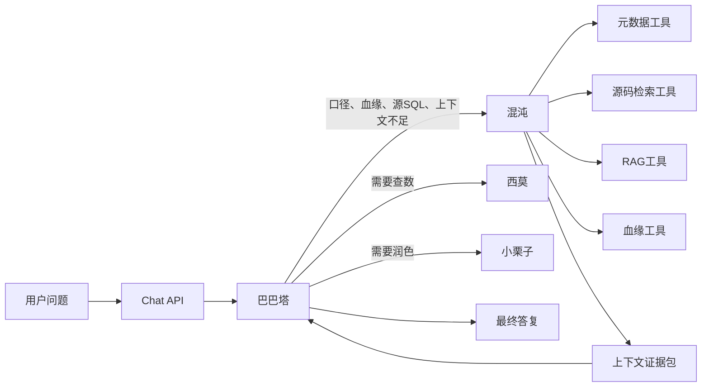

# 混沌（Hundun）上下文支撑智能体技术方案

> 对应规格：[hundun-context-agent.md](../specs/hundun-context-agent.md) v0.1.0

## 1. 目标与落地原则

### 1.1 目标

新增 `hundun` 子 Agent，用于在巴巴塔理解用户意图时补充上下文证据，包括表字段元数据、历史案例、数仓 SQL 源文件、RAG 知识库和数据血缘线索。

第一版交付目标：

- 巴巴塔可委派 `hundun`；
- `hundun` 能返回结构化“上下文证据包”；
- `hundun` 不执行查数 SQL，不生成最终业务结论；
- 已有 `ximo`、`chestnut`、Workflow 路由不回归；
- RAG 与血缘未配置时明确返回不可用；
- 本地源码检索受白名单、扩展名、数量、长度限制保护。

### 1.2 落地原则

- **先接入骨架，再接工具**：先让 `hundun` 作为 Agent 可被委派，再逐步增加上下文工具。
- **复用已有能力**：表/字段元数据复用 `src/mastra/tools/db/operations.ts`，不重复实现 Doris 查询。
- **只读与证据优先**：`hundun` 只能收集证据，不执行业务分析 SQL。
- **未配置即显式不可用**：RAG、血缘、本地源码目录未配置时，工具返回结构化不可用状态。
- **测试先行**：每个任务先写失败测试，再实现。

---

## 2. 总体架构




### 2.1 运行时接入点


| 层级        | 文件                                   | 说明                                            |
| --------- | ------------------------------------ | --------------------------------------------- |
| Agent 定义  | `src/mastra/agents/hundun.ts`        | 定义 `hundunAgent`                              |
| 指令        | `src/mastra/instructions/hundun.ts`  | 定义 `hundunDescription` 与 `hundunInstructions` |
| 指令导出      | `src/mastra/instructions/index.ts`   | 导出混沌指令                                        |
| 总管注册      | `src/mastra/agents/babata.ts`        | 将 `hundunAgent` 挂到 Supervisor                 |
| Mastra 注册 | `src/mastra/index.ts`                | 将 `hundun` 注册到 Mastra                         |
| Registry  | `src/mastra/registry.ts`             | 写入 `agentRegistry`、总管 instructions 与 label    |
| 路由        | `src/mastra/instructions/routing.ts` | 增加混沌路由规则                                      |
| 委派钩子      | `src/mastra/delegation.ts`           | 过滤上下文、追加约束、记录审计                               |
| 模型角色      | `src/lib/model.ts`                   | 增加 `MODEL_HUNDUN`                             |
| 前端标签      | `src/app/components/ChatPanel.tsx`   | 展示“混沌”委派状态                                    |


---

## 3. Agent 设计

### 3.1 `hundunDescription`

用于巴巴塔路由，必须短而明确：

```ts
export const hundunDescription =
  '上下文侦察与证据收集助手。适用于指标口径、表字段含义、数据血缘、RAG 知识库、数仓 SQL 源文件探查；只返回证据包，不执行查数 SQL，不生成最终业务结论。'
```

### 3.2 `hundunInstructions`

必须包含以下硬约束：

- 接收巴巴塔对用户意图的理解；
- 优先使用工具收集证据；
- 输出“混沌上下文证据包”；
- 每条关键判断必须附来源；
- 不执行 `execute-readonly-sql`；
- 不调用 `build-visualization`；
- 不编造未查到的 RAG、血缘或源码结果；
- 对未配置工具明确写“未配置/不可用”；
- 建议巴巴塔下一步直接委派西莫、先澄清或停止查数。

### 3.3 Agent 定义

`src/mastra/agents/hundun.ts` 按现有 `ximo` / `chestnut` 模式新增：

```ts
import { Agent } from '@mastra/core/agent'
import { getModelForRole } from '@/lib/model'
import { hundunDescription, hundunInstructions } from '@/mastra/instructions'
import { getHundunContextTools } from '@/mastra/tools/context'

export const hundunAgent = new Agent({
  id: 'hundun',
  name: '混沌',
  description: hundunDescription,
  model: getModelForRole('hundun'),
  instructions: hundunInstructions,
  tools: getHundunContextTools(),
})
```

---

## 4. 工具设计

### 4.1 工具目录

新增目录：

```text
src/mastra/tools/context/
├── index.ts
├── metadata.ts
├── source-config.ts
├── source-files.ts
├── rag.ts
├── lineage.ts
└── schemas.ts
```

### 4.2 工具清单


| 工具 ID                      | 文件                | 作用          | 数据源                                |
| -------------------------- | ----------------- | ----------- | ---------------------------------- |
| `list-context-tables`      | `metadata.ts`     | 列出候选表       | Doris `information_schema` + cache |
| `describe-context-table`   | `metadata.ts`     | 查询表字段和注释    | Doris `information_schema` + cache |
| `glob-warehouse-sources`   | `source-files.ts` | 列出白名单目录内源文件 | 本地文件系统                             |
| `search-warehouse-sources` | `source-files.ts` | 搜索源码片段      | 本地文件系统                             |
| `read-warehouse-source`    | `source-files.ts` | 读取单文件片段     | 本地文件系统                             |
| `query-rag-knowledge`      | `rag.ts`          | 查询 RAG 知识库  | 外部接口或未配置占位                         |
| `query-data-lineage`       | `lineage.ts`      | 查询血缘        | 外部接口或未配置占位                         |


### 4.3 元数据工具

`metadata.ts` 复用已有操作：

- `listTablesOperation()`
- `describeTableOperation(table)`

不要把 `executeReadonlySqlOperation()` 暴露给混沌。

输出结构建议：

```ts
type ContextTable = {
  name: string
  description?: string
}

type ContextColumn = {
  name: string
  type: string
  description?: string
}
```

### 4.4 源码工具配置

`source-config.ts` 负责读取配置：


| 配置项                            | 默认值                                 | 说明                     |
| ------------------------------ | ----------------------------------- | ---------------------- |
| `HUNDUN_SOURCE_ROOTS`          | 空                                   | 允许读取的源码根目录，多个目录用英文逗号分隔 |
| `HUNDUN_SOURCE_EXTENSIONS`     | `.sql,.hql,.md,.yaml,.yml,.ts,.tsx` | 允许检索的扩展名               |
| `HUNDUN_SOURCE_SEARCH_LIMIT`   | `20`                                | 单次搜索最大命中               |
| `HUNDUN_SOURCE_READ_MAX_CHARS` | `12000`                             | 单次读取最大字符数              |


安全规则：

- `HUNDUN_SOURCE_ROOTS` 为空时，源码工具返回 `configured:false`；
- 所有路径必须 `resolve()` 后仍在任一 root 内；
- 禁止读取 `.env`、`.pem`、`.key`、`.crt`、`.log`；
- 单次输出必须截断；
- 错误信息不能泄露敏感文件内容。

### 4.5 源码工具实现策略

优先复用本机工具并保留 Node 标准库兜底，避免新增依赖：

- `glob-warehouse-sources`：对齐通用 glob 工具语义，支持 `glob_pattern` 与 `target_directory`，递归遍历白名单 root，按扩展名和 glob 过滤；
- `search-warehouse-sources`：对齐通用 search 工具语义，支持 `pattern`、`path`、`glob`，默认优先调用本地 `ripgrep`，未安装或执行失败时降级为 TypeScript 正则搜索实现；`query` 作为旧版兼容字段；
- `read-warehouse-source`：对齐通用 read 工具语义，支持 `path`、`offset`、`limit`，按行返回内容，并继续受字符上限保护。

可通过 `HUNDUN_SOURCE_SEARCH_BACKEND=typescript` 强制使用 TypeScript 搜索，便于测试或排查本机 `ripgrep` 行为差异。

### 4.6 RAG 与血缘占位工具

第一版只定义稳定返回结构。

RAG 未配置：

```json
{
  "configured": false,
  "message": "RAG 知识库未配置，无法查询。",
  "results": []
}
```

血缘未配置：

```json
{
  "configured": false,
  "message": "数据血缘接口未配置，无法查询。",
  "results": []
}
```

如果提供 `HUNDUN_RAG_ENDPOINT` 或 `HUNDUN_LINEAGE_ENDPOINT`，后续版本再实现 HTTP 只读调用。

---

## 5. 委派设计

### 5.1 Message Filter

`filterDelegationMessages()` 增加 `hundun` 分支：

- 保留最近用户、助手、系统消息；
- 不压缩成仅最后用户消息，因为混沌需要理解上下文；
- 审计事件：`babata-hundun.context`。

建议逻辑：

```ts
if (primitiveId.includes('hundun')) {
  logAuditEvent({
    event: 'babata-hundun.context',
    primitiveId,
    primitiveType,
    messageCount: recent.length,
    messages: summarizeMessages(recent),
  })
  return recent
}
```

### 5.2 Delegation Start

`onDelegationStart()` 增加混沌约束：

- 只返回证据包；
- 不执行查数 SQL；
- 未配置工具要如实说明；
- 每条关键判断附来源；
- 建议下一步处理方。

建议 `modifiedMaxSteps` 为 `6` 到 `8`，避免源码搜索过深导致成本失控。

### 5.3 Delegation Complete

`onDelegationComplete()` 增加：

- 失败时反馈巴巴塔不要编造上下文；
- 成功时记录 `babata-hundun.result`；
- 如果返回内容完全没有证据包结构，可反馈要求混沌补充来源。

第一版只做轻量校验，不强制 JSON schema，避免模型格式抖动导致过度重试。

---

## 6. 路由设计

`routingDecisionTable` 增加混沌相关行，并调整查数行。

建议规则：


| 用户意图                                  | 处理方                  |
| ------------------------------------- | -------------------- |
| 指标口径、表含义、字段含义、数据血缘、RAG 知识库、源 SQL、历史案例 | 委派混沌（hundun）收集上下文证据包 |
| 查数但表、字段、指标口径不明确，且可通过上下文检索补齐           | 先委派混沌，再由巴巴塔决定是否委派西莫  |
| 明确查数、指标、TopN、同比、SQL                   | 直接委派西莫（ximo）         |


避免“所有查数都先混沌”，否则会增加延迟和成本。

---

## 7. 配置与环境变量

`.env.example` 新增配置时，每个配置项必须有中文注释。

```env
# 混沌可读取的数仓源码根目录，多个目录用英文逗号分隔
HUNDUN_SOURCE_ROOTS=

# 混沌源码检索允许的文件扩展名，多个扩展名用英文逗号分隔
HUNDUN_SOURCE_EXTENSIONS=.sql,.hql,.md,.yaml,.yml,.ts,.tsx

# 混沌单次源码搜索最多返回的命中条数
HUNDUN_SOURCE_SEARCH_LIMIT=20

# 混沌单次源码读取最多返回的字符数
HUNDUN_SOURCE_READ_MAX_CHARS=12000

# 混沌 RAG 知识库查询接口地址，留空表示未配置
HUNDUN_RAG_ENDPOINT=

# 混沌数据血缘查询接口地址，留空表示未配置
HUNDUN_LINEAGE_ENDPOINT=

# 混沌专用模型，留空时回退 MODEL_NAME
MODEL_HUNDUN=
```

`src/lib/model.ts` 增加：

```ts
export type AgentModelRole = 'babata' | 'ximo' | 'chestnut' | 'hundun'

const ROLE_MODEL_ENV: Record<AgentModelRole, string | undefined> = {
  babata: process.env.MODEL_BABATA,
  ximo: process.env.MODEL_XIMO,
  chestnut: process.env.MODEL_CHESTNUT,
  hundun: process.env.MODEL_HUNDUN,
}
```

---

## 8. 审计日志

沿用 `src/lib/audit-log.ts`。

新增事件：


| 事件                              | 触发点                          |
| ------------------------------- | ---------------------------- |
| `babata-hundun.context`         | `filterDelegationMessages()` |
| `babata-hundun.prompt`          | `onDelegationStart()`        |
| `babata-hundun.modified-prompt` | `onDelegationStart()`        |
| `babata-hundun.result`          | `onDelegationComplete()`     |
| `babata-hundun.feedback`        | `onDelegationComplete()`     |
| `hundun-tool.input`             | context 工具调用前                |
| `hundun-tool.result`            | context 工具成功                 |
| `hundun-tool.error`             | context 工具失败                 |


工具层可复用 `logToolAudit()`，也可在事件名中保留工具 ID。

---

## 9. 优先级任务清单

### P0 — 文档与范围冻结


| ID   | 任务          | 文件                                                 | 验收                          |
| ---- | ----------- | -------------------------------------------------- | --------------------------- |
| H0-1 | 完成规格说明      | `docs/specs/hundun-context-agent.md`               | 已链接到 `docs/specs/README.md` |
| H0-2 | 完成技术方案与任务清单 | `docs/tech/hundun-context-agent-implementation.md` | 已链接到 `docs/tech/README.md`  |


### P1 — Agent 骨架与路由


| ID   | 任务                             | 文件                                                             | 验收                                       |
| ---- | ------------------------------ | -------------------------------------------------------------- | ---------------------------------------- |
| H1-1 | 写 `hundun` instructions 测试     | `src/mastra/instructions/hundun.test.ts`                       | 测试先失败，断言职责、禁止 SQL、证据包格式                  |
| H1-2 | 新增 `hundun` instructions       | `src/mastra/instructions/hundun.ts`                            | H1-1 通过                                  |
| H1-3 | 接入 instructions barrel         | `src/mastra/instructions/index.ts`                             | TypeScript 可引用                           |
| H1-4 | 新增 `hundunAgent`               | `src/mastra/agents/hundun.ts`                                  | Agent id/name/description/model/tools 正确 |
| H1-5 | 新增模型角色                         | `src/lib/model.ts`                                             | `getModelForRole('hundun')` 可编译          |
| H1-6 | 注册到 Mastra 与 Babata Supervisor | `src/mastra/index.ts`, `src/mastra/agents/babata.ts`           | `babata` 可委派 `hundun`                    |
| H1-7 | 更新 registry 与路由                | `src/mastra/registry.ts`, `src/mastra/instructions/routing.ts` | `buildBabataInstructions()` 包含混沌         |
| H1-8 | 增加前端委派标签                       | `src/app/components/ChatPanel.tsx`                             | UI 显示“混沌”                                |


### P2 — 委派约束与审计


| ID   | 任务                  | 文件                              | 验收                                |
| ---- | ------------------- | ------------------------------- | --------------------------------- |
| H2-1 | 写 delegation 测试     | `src/mastra/delegation.test.ts` | 覆盖 prompt 修改、context 审计、result 审计 |
| H2-2 | 增加混沌 message filter | `src/mastra/delegation.ts`      | `babata-hundun.context` 可记录       |
| H2-3 | 增加混沌 start hook     | `src/mastra/delegation.ts`      | prompt 追加证据包与禁止查数约束               |
| H2-4 | 增加混沌 complete hook  | `src/mastra/delegation.ts`      | 失败反馈不编造，成功记录结果                    |


### P3 — 元数据与占位检索工具


| ID   | 任务                    | 文件                                     | 验收                                |
| ---- | --------------------- | -------------------------------------- | --------------------------------- |
| H3-1 | 新增 context tool index | `src/mastra/tools/context/index.ts`    | `getHundunContextTools()` 导出工具集合  |
| H3-2 | 封装表元数据工具              | `src/mastra/tools/context/metadata.ts` | 只暴露 list/describe，不暴露 execute SQL |
| H3-3 | 新增 RAG 占位工具           | `src/mastra/tools/context/rag.ts`      | 未配置时返回 `configured:false`         |
| H3-4 | 新增血缘占位工具              | `src/mastra/tools/context/lineage.ts`  | 未配置时返回 `configured:false`         |
| H3-5 | 工具审计                  | `src/mastra/tools/context/*`           | input/result/error 可审计            |


### P4 — 本地源码探查工具


| ID   | 任务           | 文件                                               | 验收                      |
| ---- | ------------ | ------------------------------------------------ | ----------------------- |
| H4-1 | 写源码配置测试      | `src/mastra/tools/context/source-config.test.ts` | 覆盖 root 为空、扩展名默认值、数值默认值 |
| H4-2 | 实现源码配置解析     | `src/mastra/tools/context/source-config.ts`      | 配置解析通过测试                |
| H4-3 | 写路径安全测试      | `src/mastra/tools/context/source-files.test.ts`  | 覆盖路径穿越、敏感扩展名、root 外路径   |
| H4-4 | 实现 glob 工具   | `src/mastra/tools/context/source-files.ts`       | 只返回白名单文件                |
| H4-5 | 实现 search 工具 | `src/mastra/tools/context/source-files.ts`       | 返回路径、行号、上下文片段并限制数量      |
| H4-6 | 实现 read 工具   | `src/mastra/tools/context/source-files.ts`       | 返回截断内容和 truncated 标记    |


### P5 — 配置与文档同步


| ID   | 任务        | 文件                                  | 验收                 |
| ---- | --------- | ----------------------------------- | ------------------ |
| H5-1 | 增加 env 示例 | `.env.example`                      | 每项前一行有中文注释         |
| H5-2 | 更新技术索引    | `docs/tech/README.md`               | 链接技术方案             |
| H5-3 | 更新实施任务总表  | `docs/tech/implementation-tasks.md` | 增加 Hundun P5 分组或链接 |


### P6 — 验证与代码审查


| ID   | 任务                | 命令                                                              | 验收                      |
| ---- | ----------------- | --------------------------------------------------------------- | ----------------------- |
| H6-1 | 跑 instructions 测试 | `pnpm exec tsx --test "src/mastra/instructions/hundun.test.ts"` | 通过                      |
| H6-2 | 跑 registry 测试     | `pnpm exec tsx --test "src/mastra/registry.test.ts"`            | 通过                      |
| H6-3 | 跑 delegation 测试   | `pnpm exec tsx --test "src/mastra/delegation.test.ts"`          | 通过                      |
| H6-4 | 跑 context 工具测试    | `pnpm exec tsx --test "src/mastra/tools/context/*.test.ts"`     | 通过                      |
| H6-5 | 跑类型检查             | `pnpm exec tsc --noEmit`                                        | 通过                      |
| H6-6 | 请求代码审查            | `code-reviewer`                                                 | 无 Critical/Important 问题 |


---

## 10. 建议执行顺序

```text
H1-1 → H1-2 → H1-3 → H1-4 → H1-5 → H1-6 → H1-7 → H1-8
        ↓
H2-1 → H2-2 → H2-3 → H2-4
        ↓
H3-1 → H3-2 → H3-3 → H3-4 → H3-5
        ↓
H4-1 → H4-2 → H4-3 → H4-4 → H4-5 → H4-6
        ↓
H5-1 → H5-2 → H5-3
        ↓
H6-1 → H6-2 → H6-3 → H6-4 → H6-5 → H6-6
```

建议按 P1/P2/P3/P4 分批提交，避免一次 PR 同时引入 Agent、路由、工具和配置，降低 review 成本。

---

## 11. 关键风险与处理


| 风险              | 影响        | 处理                                                      |
| --------------- | --------- | ------------------------------------------------------- |
| 巴巴塔过度委派混沌       | 延迟增加、成本增加 | 路由中限定“口径/血缘/源 SQL/上下文不足”才委派                             |
| 混沌误输出业务结论       | 用户误信未执行数据 | instructions 与 delegation suffix 明确禁止，complete hook 可提示 |
| 本地文件读取越权        | 泄露敏感文件    | root 白名单、扩展名白名单、路径 resolve 校验、敏感扩展名黑名单                  |
| RAG/血缘未配置却被当作成功 | 虚假上下文     | 工具返回 `configured:false`，instructions 要求如实说明             |
| 与西莫职责重叠         | 路由混乱      | 混沌只收集证据，西莫才查数和生成分析                                      |
| 审计日志过大          | 存储膨胀      | 对源码片段和工具结果做长度限制                                         |


---

## 12. Review 重点

请重点 review：

- 路由边界是否符合预期：是否只在口径、血缘、源 SQL、上下文不足时委派混沌；
- 混沌是否应该在第一版拥有本地源码探查工具，还是先只做元数据与占位接口；
- RAG/血缘接口第一版“未配置返回不可用”的策略是否可接受；
- 本地源码默认扩展名是否需要包含其他类型，例如 `.py`、`.java`、`.scala`；
- `HUNDUN_SOURCE_ROOTS` 是否应该支持多个外部仓库路径；
- 是否需要把历史 few-shot 知识检索纳入第一版 P3。

